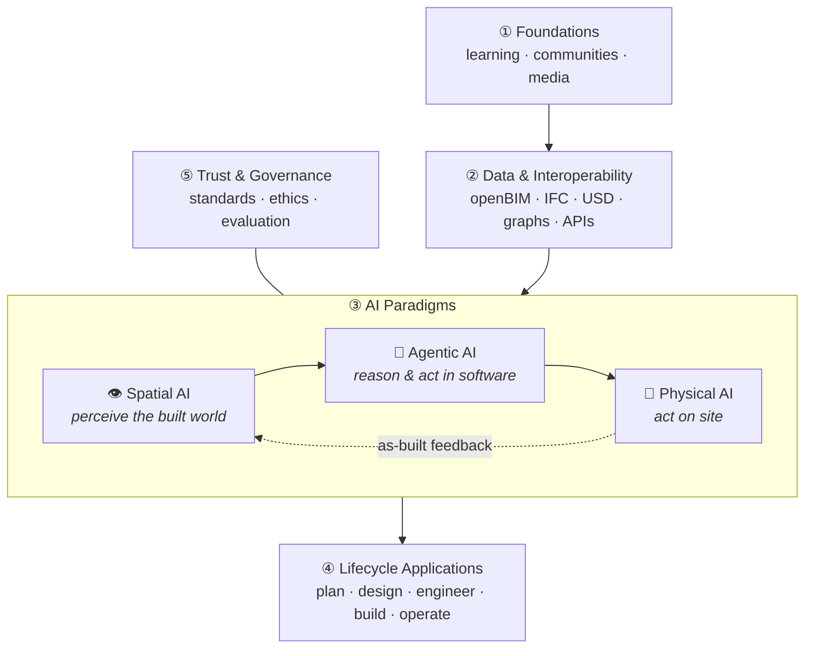

# Awesome AI for AEC Delivery 

> A curated list of tools, platforms, datasets, research and standards that help **architects, engineers and builders** apply **Artificial Intelligence** across the full Architecture, Engineering & Construction (AEC) lifecycle, from first sketch to operating asset. It includes dedicated sections on **Agentic AI**, **Spatial AI** and **Physical AI**.

AEC is a physical, regulated, safety-critical industry. This list treats **trust, traceability and professional responsibility** as core concerns. Every section assumes that a qualified human stays accountable for what gets built.

---

## How This List Is Organised

The taxonomy has **five layers**. Each layer builds on the one below it:

**A mental model:** think of an AI-enabled project as a body.
- **Spatial AI** is the *eyes*. It turns scans, photos and drawings into structured geometry and meaning.
- **Agentic AI** is the *brain and the office hands*. It reasons over models, codes and documents, and it operates design software through tools.
- **Physical AI** is the *site hands*. Robots and autonomous machines carry out work in the real world.
- **Data & Interoperability** is the *nervous system*. It carries information between all three.
- **Governance** is the *conscience*. It decides what the body is allowed to do and who answers for it.

### Paradigm × Lifecycle Map

Use this table to jump to the right section for your stage of delivery.

| | Plan & Feasibility | Design | Engineer & Analyse | Construct | Operate & Maintain |
|---|---|---|---|---|---|
| **Generative / Predictive AI** | [Site & feasibility](#site-feasibility--massing) | [Generative design](#generative--computational-design) | [Simulation surrogates](#engineering-analysis--simulation) | [Scheduling & cost](#planning-scheduling--cost) | [Building performance](#operations-facilities--digital-twins) |
| **Agentic AI** | [Zoning & permitting](#permitting-codes--compliance) | [MCP servers for design tools](#mcp-servers-for-aec-tools) | [Code compliance agents](#permitting-codes--compliance) | [Construction document agents](#documents-drawings--knowledge) | [Asset copilots](#operations-facilities--digital-twins) |
| **Spatial AI** | [Geospatial & city data](#geospatial--city-scale) | [Floor plan understanding](#drawing--floor-plan-understanding) | [Scan-to-BIM](#scan-to-bim--3d-understanding) | [Progress monitoring](#site-progress--quality-monitoring) | [Reality-captured twins](#reality-capture--neural-reconstruction) |
| **Physical AI** | [Survey drones](#drones--legged-inspection) | [Robotic fabrication](#robotic-fabrication--digital-construction) | [Simulation & world models](#simulation-world-models--robot-learning) | [Site robotics](#on-site-construction-robotics) | [Inspection robots](#drones--legged-inspection) |

**Legend:** 🟢 open source · 💼 commercial · 📄 paper · 📊 dataset · 🎓 learning resource

---

## Contents

- [Foundations](#foundations)
  - [Learning Resources](#learning-resources)
  - [Books](#books)
  - [Related Awesome Lists](#related-awesome-lists)
- [Data & Interoperability](#data--interoperability)
  - [openBIM & Open Standards](#openbim--open-standards)
  - [Open-Source BIM Toolkits](#open-source-bim-toolkits)
  - [AEC Data Platforms & APIs](#aec-data-platforms--apis)
  - [Semantic & Building Ontologies](#semantic--building-ontologies)
  - [Computational Design Environments](#computational-design-environments)
- [AI Paradigms](#ai-paradigms)
  - [Agentic AI](#agentic-ai)
    - [MCP Servers for AEC Tools](#mcp-servers-for-aec-tools)
    - [Vendor Copilots & Assistants](#vendor-copilots--assistants)
    - [Agent Frameworks](#agent-frameworks)
    - [Agent Observability & Evaluation](#agent-observability--evaluation)
    - [Agentic AEC Research](#agentic-aec-research)
  - [Spatial AI](#spatial-ai)
    - [Reality Capture & Neural Reconstruction](#reality-capture--neural-reconstruction)
    - [Scan-to-BIM & 3D Understanding](#scan-to-bim--3d-understanding)
    - [Spatial Foundation Models & Scene Graphs](#spatial-foundation-models--scene-graphs)
    - [Drawing & Floor Plan Understanding](#drawing--floor-plan-understanding)
    - [Geospatial & City Scale](#geospatial--city-scale)
  - [Physical AI](#physical-ai)
    - [On-Site Construction Robotics](#on-site-construction-robotics)
    - [Autonomous Heavy Equipment](#autonomous-heavy-equipment)
    - [Drones & Legged Inspection](#drones--legged-inspection)
    - [Robotic Fabrication & Digital Construction](#robotic-fabrication--digital-construction)
    - [Simulation, World Models & Robot Learning](#simulation-world-models--robot-learning)
- [Lifecycle Applications](#lifecycle-applications)
  - [Site, Feasibility & Massing](#site-feasibility--massing)
  - [Generative & Computational Design](#generative--computational-design)
  - [AI Visualisation & Rendering](#ai-visualisation--rendering)
  - [Engineering Analysis & Simulation](#engineering-analysis--simulation)
  - [Permitting, Codes & Compliance](#permitting-codes--compliance)
  - [Documents, Drawings & Knowledge](#documents-drawings--knowledge)
  - [Estimating & Quantity Take-off](#estimating--quantity-take-off)
  - [Planning, Scheduling & Cost](#planning-scheduling--cost)
  - [Site Progress & Quality Monitoring](#site-progress--quality-monitoring)
  - [Health, Safety & Computer Vision](#health-safety--computer-vision)
  - [Operations, Facilities & Digital Twins](#operations-facilities--digital-twins)
- [Datasets & Benchmarks](#datasets--benchmarks)
- [Research Papers & Surveys](#research-papers--surveys)
- [Trust & Governance](#trust--governance)
- [Communities, Events & Media](#communities-events--media)
- [Contributing](#contributing)
- [License](#license)

---

## Foundations

### Learning Resources

- 🎓 [Hugging Face Agents Course](https://huggingface.co/learn/agents-course) - Free course on building and evaluating AI agents. Covers the concepts behind agentic workflows for AEC.
- 🎓 [Practical Deep Learning for Coders (fast.ai)](https://course.fast.ai) - Hands-on, code-first deep learning course. A good on-ramp for engineers who already know Python.
- 🎓 [Parametric Camp](https://www.youtube.com/@ParametricCamp) - Video tutorials on computational design, Grasshopper and coding for architects.
- 🎓 [DigitalFUTURES](https://www.digitalfutures.world) - Free global workshops and talks on computational design, AI and robotics in architecture.
- 🎓 [Model Context Protocol docs](https://modelcontextprotocol.io) - The open protocol behind most AEC tool-using agents. Start here before building an MCP server for Revit, Rhino or IFC.
- 🎓 [LeRobot](https://github.com/huggingface/lerobot) - Hugging Face's open library and tutorials for real-world robot learning. A practical entry point to Physical AI.
- 🎓 [ArchiGAN: a Generative Stack for Apartment Building Design](https://developer.nvidia.com/blog/archigan-generative-stack-apartment-building-design/) - A widely cited early demonstration of GANs applied to floor plan generation, by Stanislas Chaillou.

### Books

- [Data-Driven Construction](https://datadrivenconstruction.io) - Artem Boiko's guide to data, automation and analytics in construction, with free open-access chapters.
- [Architectural Intelligence: How Designers and Architects Created the Digital Landscape](https://mitpress.mit.edu/9780262537001/architectural-intelligence/) - Molly Wright Steenson (MIT Press). The history of AI and architecture, told through Alexander, Negroponte, Price and others.

### Related Awesome Lists

- [awesome-mcp-servers](https://github.com/punkpeye/awesome-mcp-servers) - General MCP server directory. Useful for wiring AEC agents to non-AEC tools.
- [awesome-3D-gaussian-splatting](https://github.com/MrNeRF/awesome-3D-gaussian-splatting) - Comprehensive Gaussian splatting papers and code.
- [awesome-point-cloud-analysis](https://github.com/Yochengliu/awesome-point-cloud-analysis) - Point cloud deep learning papers and datasets.
- [awesome-robotics](https://github.com/kiloreux/awesome-robotics) - General robotics resources.

---

## Data & Interoperability

> AI is only as good as the data it can see. Clean, open, semantically rich building data is the precondition for every paradigm below.

### openBIM & Open Standards

- [IFC (Industry Foundation Classes)](https://technical.buildingsmart.org/standards/ifc/) - The ISO 16739 open schema for building and infrastructure data. It is the lingua franca for AI that reads BIM.
- [IDS (Information Delivery Specification)](https://github.com/buildingSMART/IDS) - 🟢 Machine-readable information requirements. Use it to check whether AI-generated or AI-edited models meet the brief.
- [BCF (BIM Collaboration Format)](https://github.com/buildingSMART/BCF-XML) - 🟢 Open format for issues and clashes. Agents can use it to raise traceable findings.
- [ISO 19650](https://www.iso.org/standard/68078.html) - The international framework for information management using BIM.
- [OpenUSD](https://openusd.org) - 🟢 Universal Scene Description. Increasingly the bridge between BIM, simulation and Physical AI (for example, NVIDIA Omniverse).
- [buildingSMART International](https://www.buildingsmart.org) - Standards body for openBIM.

### Open-Source BIM Toolkits

- [IfcOpenShell](https://github.com/IfcOpenShell/IfcOpenShell) - 🟢 Python/C++ library for reading, writing and analysing IFC. The backbone of most open AI-for-BIM pipelines.
- [Bonsai](https://bonsaibim.org) - 🟢 Native IFC authoring inside Blender (formerly BlenderBIM). Many IFC MCP servers target it.
- [That Open Engine](https://github.com/ThatOpen/engine_components) - 🟢 Web-based BIM toolkit (formerly IFC.js) for building browser apps on IFC.
- [web-ifc](https://github.com/ThatOpen/engine_web-ifc) - 🟢 High-speed IFC parsing in the browser via WebAssembly.
- [xBIM Toolkit](https://github.com/xBimTeam) - 🟢 .NET libraries for IFC.
- [ezdxf](https://github.com/mozman/ezdxf) - 🟢 Python library for reading and writing DXF drawings. Useful for 2D drawing AI pipelines.

### AEC Data Platforms & APIs

- [Speckle](https://speckle.systems) - 🟢 Open-source data hub that connects Revit, Rhino, Grasshopper, Blender, Power BI and more. A natural data layer for AI ([server](https://github.com/specklesystems/speckle-server), [specklepy](https://github.com/specklesystems/specklepy)).
- [Autodesk Platform Services](https://aps.autodesk.com) - 💼 Cloud APIs for Autodesk data, including the AEC Data Model, Model Derivative and Automation APIs.
- [Rhino.Compute](https://github.com/mcneel/compute.rhino3d) - 🟢 Runs Rhino and Grasshopper geometry headlessly as a service. Useful for AI pipelines that need real geometry kernels.
- [Hypar Elements](https://github.com/hypar-io/Elements) - 🟢 Code-first building element library behind the [Hypar](https://hypar.io) platform.
- [Open Source Construction](https://opensource.construction) - Directory and community for open-source projects in construction.

### Semantic & Building Ontologies

- [Brick Schema](https://brickschema.org) - 🟢 Ontology for building systems and sensors. Grounds AI agents in operational building data.
- [Project Haystack](https://project-haystack.org) - 🟢 Semantic tagging standard for building equipment and IoT data.
- [RealEstateCore](https://www.realestatecore.io) - 🟢 Ontology for real estate and smart buildings, used with Azure Digital Twins.
- [Topologic](https://topologic.app) - 🟢 Non-manifold topology for spatial reasoning and graph ML on buildings ([topologicpy](https://github.com/wassimj/topologicpy)).

### Computational Design Environments

- [Grasshopper](https://www.grasshopper3d.com) - Visual programming for Rhino. Home to many AI and optimisation plug-ins.
- [Dynamo](https://dynamobim.org) - 🟢 Visual programming for Revit and other Autodesk tools.
- [pyRevit](https://github.com/pyrevitlabs/pyRevit) - 🟢 Rapid Python add-in development for Revit. A common way to host AI scripts.
- [Rhino.Inside.Revit](https://github.com/mcneel/rhino.inside-revit) - 🟢 Runs Rhino and Grasshopper inside Revit.
- [COMPAS](https://compas.dev) - 🟢 Open-source Python framework for computational research in AEC, from ETH Zurich ([GitHub](https://github.com/compas-dev/compas)).

---

## AI Paradigms

### Agentic AI

> **What it is:** LLM-driven systems that plan, call tools and take multi-step actions. Examples include querying a model, editing a Revit family, checking a clause or drafting an RFI response.
> **Why it matters in AEC:** most delivery effort happens inside software and documents. Agents can work there directly, but they need guardrails, audit trails and human sign-off.

#### MCP Servers for AEC Tools

- [Autodesk Revit Public MCP Server](https://www.autodesk.com/blogs/aec/2026/06/17/revit-public-mcp-server/) - 💼 Autodesk's official, supported MCP server for Revit 2027. It works with any MCP-compatible LLM client.
- [Revit Gen AI: MCP, RAG and Vibe](https://blog.autodesk.io/revit-gen-ai-mcp-rag-and-vibe/) - Autodesk developer blog on community Revit MCP experiments.
- [mcp-servers-for-revit](https://github.com/mcp-servers-for-revit) - 🟢 Community framework that pairs a Node.js MCP server with a C# Revit add-in over WebSockets (Revit 2020–2026).
- [revit-mcp](https://github.com/revit-mcp) - 🟢 Original community Revit MCP server and plug-in.
- [BlenderMCP](https://github.com/ahujasid/blender-mcp) - 🟢 Connects Blender to LLMs through MCP for prompt-driven 3D modelling.
- [Bonsai_mcp](https://github.com/JotaDeRodriguez/Bonsai_mcp) - 🟢 BlenderMCP fork with IFC support through Bonsai and IfcOpenShell.
- [ifc-bonsai-mcp / MCP4IFC](https://github.com/Show2Instruct/ifc-bonsai-mcp) - 🟢 MCP server that lets LLMs read, create and edit IFC models in Bonsai ([project page](https://show2instruct.github.io/mcp4ifc/), 📄 [paper](https://arxiv.org/abs/2511.05533)).
- [RhinoMCP](https://github.com/jingcheng-chen/rhinomcp) - 🟢 Lets LLMs model geometry, read documents and build Grasshopper definitions in Rhino.
- [rhino-grasshopper-mcp](https://github.com/dongwoosuk/rhino-grasshopper-mcp) - 🟢 Grasshopper-focused MCP server with live connection to running Rhino instances.
- [speckle-mcp](https://github.com/bimgeek/speckle-mcp) - 🟢 MCP server for querying Speckle projects and model data.

> ⚠️ Community MCP servers often expose arbitrary code execution inside your authoring tool. Run them in sandboxed environments, on copies of production models, and review every change before it is committed.

#### Vendor Copilots & Assistants

- [Autodesk Assistant & neural CAD (AU 2025)](https://aecmag.com/ai/autodesk-shows-its-ai-hand/) - AEC Magazine on Autodesk's agentic assistant, first piloted in Revit, and its neural CAD foundation models for Forma.
- [Bentley Infrastructure AI](https://www.bentley.com/news/bentley-systems-advances-infrastructure-ai-with-new-applications-and-industry-collaboration/) - 💼 Bentley Copilot, an AI drawing-annotation agent for OpenRoads/OpenRail, and the Infrastructure AI Co-Innovation Initiative.
- [ArchiLabs](https://archilabs.ai) - 💼 AI copilot that automates repetitive Revit tasks from natural language.
- [Nomic](https://www.nomic.ai) - 💼 AI agents for engineering and construction document sets.
- [Trunk Tools](https://trunktools.com) - 💼 AI agents that answer questions and automate workflows across construction project documents.
- [Augmenta](https://www.augmenta.ai) - 💼 Generative and agentic AI for automated building systems design (electrical, MEP).

#### Agent Frameworks

- [LangGraph](https://github.com/langchain-ai/langgraph) - 🟢 Stateful, graph-based orchestration for multi-agent workflows.
- [Claude Agent SDK](https://github.com/anthropics/claude-agent-sdk-python) - 🟢 Python SDK for building tool-using agents with MCP support.
- [OpenAI Agents SDK](https://github.com/openai/openai-agents-python) - 🟢 Lightweight framework for multi-agent workflows with handoffs and guardrails.
- [AutoGen](https://github.com/microsoft/autogen) - 🟢 Microsoft's framework for multi-agent conversation and collaboration.
- [smolagents](https://github.com/huggingface/smolagents) - 🟢 Minimal code-acting agents from Hugging Face.

#### Agent Observability & Evaluation

> In regulated work, an agent action without a trace is an action you cannot defend. Log every prompt, tool call and model change.

- [Langfuse](https://langfuse.com) - 🟢 Open-source tracing, evaluation and prompt management for LLM applications.
- [Arize Phoenix](https://github.com/Arize-ai/phoenix) - 🟢 Open-source LLM tracing and evaluation built on OpenTelemetry.
- [Inspect AI](https://inspect.aisi.org.uk) - 🟢 UK AI Security Institute's framework for rigorous LLM and agent evaluations.
- [AEC-Bench](https://github.com/nomic-ai/aec-bench) - 🟢📊 Multimodal benchmark for agents working on real construction drawings and project documents (📄 [paper](https://arxiv.org/abs/2603.29199)).

#### Agentic AEC Research

- 📄 [Text2BIM: Generating Building Models Using an LLM-based Multi-Agent Framework](https://arxiv.org/abs/2408.08054) - Product owner, architect, programmer and reviewer agents produce editable BIM in Vectorworks, with a rule-based checker in the loop.
- 📄 [A Reference Architecture for MCP Servers in Agentic BIM](https://arxiv.org/abs/2601.00809) - Modular, API-agnostic design for reproducible agent–BIM interaction, plus a survey of existing BIM MCP servers.
- 📄 [MCP4IFC](https://arxiv.org/abs/2511.05533) - Framework for LLM-driven IFC manipulation through IfcOpenShell and Bonsai.
- 📄 [LLM-Driven Code Compliance Checking in BIM](https://arxiv.org/abs/2506.20551) - Converts regulations into executable Python checks that run in Revit.

### Spatial AI

> **What it is:** AI that perceives, reconstructs and reasons about 3D space. It turns pixels and points into walls, rooms, elements and relationships.
> **Why it matters in AEC:** it closes the gap between *as-designed* and *as-built*. That gap is where most cost, risk and rework sits.

#### Reality Capture & Neural Reconstruction

- [3D Gaussian Splatting](https://github.com/graphdeco-inria/gaussian-splatting) - 🟢 Reference implementation of real-time radiance field rendering (📄 [paper](https://arxiv.org/abs/2308.04079)).
- [Nerfstudio](https://github.com/nerfstudio-project/nerfstudio) - 🟢 Modular framework for NeRFs and splats.
- [gsplat](https://github.com/nerfstudio-project/gsplat) - 🟢 Fast, CUDA-accelerated Gaussian splatting library.
- [COLMAP](https://colmap.github.io) - 🟢 Structure-from-Motion and Multi-View Stereo. The standard first step in photogrammetry.
- [OpenDroneMap](https://www.opendronemap.org) - 🟢 Open-source drone photogrammetry: orthophotos, point clouds and meshes.
- [Introducing Gaussian Splats for AEC](https://aecmag.com/reality-capture-modelling/introducing-gaussian-splats-for-aec/) - AEC Magazine primer on splats for site documentation and AI training.
- [NavVis](https://www.navvis.com) - 💼 Mobile mapping systems for large indoor and outdoor reality capture.
- [Matterport](https://matterport.com) - 💼 Digital twin capture for existing buildings.
- [Polycam](https://poly.cam) - 💼 Mobile LiDAR, photogrammetry and splat capture.
- [Apple RoomPlan](https://developer.apple.com/augmented-reality/roomplan/) - 💼 On-device LiDAR room scanning API that outputs parametric room layouts.

#### Scan-to-BIM & 3D Understanding

- [Cloud2BIM](https://arxiv.org/abs/2503.11498) - 🟢📄 Open-source pipeline that converts large point clouds into IFC.
- [Scan-to-BIM (CVPR 2024)](https://github.com/Saiga1105/Scan-to-BIM-CVPR-2024) - 🟢 Deep-learning parametric IFC reconstruction of walls, floors, ceilings and doors.
- [pystruct3d](https://github.com/humantecheu/pystruct3d) - 🟢 Hybrid segmentation and geometric reconstruction pipeline to IFC (BIMStruct3D).
- [Pointcept](https://github.com/Pointcept/Pointcept) - 🟢 Codebase for point cloud perception, including Point Transformer V3 (📄 [paper](https://arxiv.org/abs/2312.10035)).
- [Open3D](https://www.open3d.org) - 🟢 Library for 3D data processing.
- [CloudCompare](https://www.cloudcompare.org) - 🟢 Point cloud and mesh processing and comparison.
- [PDAL](https://pdal.io) - 🟢 Point Data Abstraction Library for LiDAR pipelines.
- [Segment Anything 2](https://github.com/facebookresearch/sam2) - 🟢 Promptable segmentation for images and video. Widely used to label site imagery.

#### Spatial Foundation Models & Scene Graphs

- [SpatialLM](https://github.com/manycore-research/SpatialLM) - 🟢 LLM that turns 3D point clouds into structured layouts (walls, doors, windows, oriented object boxes).
- [SceneScript](https://www.projectaria.com/scenescript/) - Meta's research on reconstructing scenes as structured language commands for architectural layouts.
- [Hydra](https://github.com/MIT-SPARK/Hydra) - 🟢 Real-time 3D scene graph construction from MIT SPARK Lab.
- [ConceptGraphs](https://concept-graphs.github.io) - Open-vocabulary 3D scene graphs for perception and planning.
- [World Labs](https://www.worldlabs.ai) - 💼 Large world models that generate and reason about 3D environments.
- [Niantic Spatial](https://www.nianticspatial.com) - 💼 Geospatial models and large-scale reconstruction for geolocated spatial AI.

#### Drawing & Floor Plan Understanding

- [CubiCasa5K](https://github.com/CubiCasa/CubiCasa5k) - 🟢📊 5,000 floor plans with 80+ object categories, plus a multi-task baseline model.
- [FloorPlanCAD](https://floorplancad.github.io) - 📊 16,000+ vector CAD floor plans annotated for panoptic symbol spotting.
- [ArchCAD-400K](https://arxiv.org/abs/2503.22346) - 📊📄 Large-scale architectural CAD drawing dataset with a symbol-spotting baseline.
- [Docling](https://github.com/docling-project/docling) - 🟢 Converts PDFs (including specifications and reports) into structured data for LLM pipelines.
- [Unstructured](https://github.com/Unstructured-IO/unstructured) - 🟢 Document parsing and chunking for retrieval-augmented generation.

#### Geospatial & City Scale

- [Overture Maps](https://overturemaps.org) - 🟢📊 Open global map data, including buildings, places and transportation.
- [Google Open Buildings](https://sites.research.google/open-buildings/) - 📊 AI-derived building footprints across Africa, Asia and Latin America.
- [Microsoft Global ML Building Footprints](https://github.com/microsoft/GlobalMLBuildingFootprints) - 🟢📊 1.4B+ building footprints detected from imagery.
- [Cesium](https://cesium.com) - 🟢💼 3D Tiles and geospatial platform for city-scale digital twins.

### Physical AI

> **What it is:** AI that senses and acts in the physical world. This covers robots, autonomous machines, drones and the foundation models and simulators that train them.
> **Why it matters in AEC:** labour shortages, safety and productivity. Construction sites are the hardest environment robots face: unstructured, changing, outdoors and shared with people.

#### On-Site Construction Robotics

- [Dusty Robotics](https://www.dustyrobotics.com) - 💼 BIM-driven layout robots that print floor layouts directly onto slabs.
- [Rugged Robotics](https://www.ruggedrobotics.com) - 💼 Robotic layout-as-a-service.
- [Civ Robotics](https://www.civrobotics.com) - 💼 Autonomous surveying and staking robots for solar and civil sites.
- [Canvas](https://www.canvas.build) - 💼 Drywall finishing robot.
- [Okibo](https://okibo.com) - 💼 Autonomous plastering and painting robots.
- [Advanced Construction Robotics](https://www.advancedconstructionrobotics.com) - 💼 TyBot and IronBot rebar-tying and placing robots for bridge decks.
- [Construction Robotics](https://www.construction-robotics.com) - 💼 SAM masonry robot and MULE material lift assist.
- [Monumental](https://www.monumental.co) - 💼 Autonomous bricklaying robots.
- [FBR (Hadrian X)](https://www.fbr.com.au) - 💼 Large-scale outdoor bricklaying robot.
- [Kewazo](https://www.kewazo.com) - 💼 Robotic scaffolding logistics and site data.
- [50 Companies Delivering Robotics in Construction](https://www.bdcnetwork.com/aec-tech/article/55394058/50-companies-delivering-robotics-in-construction) - Building Design + Construction market map.

#### Autonomous Heavy Equipment

- [Built Robotics](https://www.builtrobotics.com) - 💼 Autonomous piling and trenching systems, used heavily on solar farms.
- [Bedrock Robotics](https://bedrockrobotics.com) - 💼 Retrofit autonomy for excavators and earthmoving fleets.
- [Gravis Robotics](https://gravisrobotics.com) - 💼 ETH Zurich spin-out that turns heavy machinery into autonomous robots.

#### Drones & Legged Inspection

- [Boston Dynamics Spot](https://bostondynamics.com/products/spot/) - 💼 Legged robot for autonomous site walks, reality capture and inspection.
- [Skydio](https://www.skydio.com) - 💼 Autonomous drones for infrastructure inspection and site capture.
- [DroneDeploy](https://www.dronedeploy.com) - 💼 Drone and ground reality capture with AI progress analytics.

#### Robotic Fabrication & Digital Construction

- [COMPAS FAB](https://github.com/compas-dev/compas_fab) - 🟢 Robotic fabrication planning and control for architecture (ROS, MoveIt).
- [Robots in Architecture (KUKA|prc)](https://robotsinarchitecture.org) - Parametric robot control for Grasshopper and associated research community.
- [ICON](https://www.iconbuild.com) - 💼 Large-scale 3D printing of buildings.
- [COBOD](https://cobod.com) - 💼 Construction 3D printers.
- [NCCR Digital Fabrication](https://dfab.ch) - Swiss research programme on robotics and digital fabrication in architecture.
- [Gramazio Kohler Research](https://gramaziokohler.arch.ethz.ch) - ETH Zurich pioneers of robotic architecture.
- [ICD University of Stuttgart](https://www.icd.uni-stuttgart.de) - Institute for Computational Design and Construction.

#### Simulation, World Models & Robot Learning

- [NVIDIA Omniverse](https://www.nvidia.com/en-us/omniverse/) - 💼 OpenUSD-based platform for physically accurate digital twins and robot simulation.
- [NVIDIA Cosmos](https://www.nvidia.com/en-us/ai/cosmos/) - 🟢 World foundation models for generating synthetic training data for physical AI ([GitHub](https://github.com/nvidia-cosmos)).
- [Isaac Sim](https://developer.nvidia.com/isaac/sim) / [Isaac Lab](https://github.com/isaac-sim/IsaacLab) - 🟢 Robot simulation and reinforcement learning.
- [MuJoCo](https://mujoco.org) - 🟢 Physics engine for robotics research.
- [ROS 2](https://docs.ros.org) - 🟢 Robot Operating System, the middleware behind most research construction robots.
- [Open X-Embodiment](https://robotics-transformer-x.github.io) - 🟢📊 Cross-robot dataset and RT-X models (📄 [paper](https://arxiv.org/abs/2310.08864)).
- [OpenVLA](https://openvla.github.io) - 🟢 Open vision-language-action model for robot manipulation.
- [openpi](https://github.com/Physical-Intelligence/openpi) - 🟢 Physical Intelligence's open-source π0 VLA models.

---

## Lifecycle Applications

### Site, Feasibility & Massing

- [Autodesk Forma](https://www.autodesk.com/products/forma/overview) - 💼 Cloud early-stage planning with AI-powered wind, daylight, noise and microclimate analysis.
- [TestFit](https://www.testfit.io) - 💼 Real-time site and building configurator for feasibility studies.
- [Archistar](https://www.archistar.ai) - 💼 Property site analysis, generative feasibility and AI e-permitting.
- [Arcol](https://www.arcol.io) - 💼 Collaborative browser-based early-stage BIM.

### Generative & Computational Design

- [Finch3D](https://www.finch3d.com) - 💼 Graph-based generative floor plan design.
- [Higharc](https://www.higharc.com) - 💼 Generative design and automation platform for homebuilders.
- [Snaptrude](https://www.snaptrude.com) - 💼 Browser-based BIM with AI-assisted design.
- [Maket](https://www.maket.ai) - 💼 Generative residential floor plans from requirements.
- [Wallacei](https://www.wallacei.com) - Evolutionary multi-objective optimisation for Grasshopper.
- [House-GAN++](https://github.com/ennauata/houseganpp) - 🟢📄 Graph-constrained generative floor plan layouts.
- [HouseDiffusion](https://github.com/aminshabani/house_diffusion) - 🟢📄 Diffusion-based vector floor plan generation (📄 [paper](https://arxiv.org/abs/2211.13287)).
- [Graph2Plan](https://github.com/HanHan55/Graph2plan) - 🟢📄 Floor plan generation from layout graphs (📄 [paper](https://arxiv.org/abs/2004.13204)).

### AI Visualisation & Rendering

- [Veras (EvolveLAB)](https://www.evolvelab.io/veras) - 💼 AI rendering plug-in for Revit, Rhino, SketchUp and Forma.
- [LookX](https://www.lookx.ai) - 💼 Generative AI rendering trained for architecture.
- [ComfyUI](https://github.com/comfyanonymous/ComfyUI) - 🟢 Node-based diffusion workflow engine popular for controlled architectural visualisation.
- [ControlNet](https://github.com/lllyasviel/ControlNet) - 🟢 Conditions diffusion models on edges, depth or line drawings to keep design intent intact.

### Engineering Analysis & Simulation

- [Ladybug Tools](https://www.ladybug.tools) - 🟢 Environmental, daylight and energy analysis for Grasshopper and Python ([GitHub](https://github.com/ladybug-tools)).
- [EnergyPlus](https://energyplus.net) / [OpenStudio](https://openstudio.net) - 🟢 US DOE whole-building energy simulation. A common source of training data for ML surrogates.
- [OpenSeesPy](https://github.com/zhuminjie/OpenSeesPy) - 🟢 Python interface to [OpenSees](https://opensees.berkeley.edu) for structural and earthquake engineering.
- [Karamba3D](https://www.karamba3d.com) - 💼 Parametric structural analysis in Grasshopper.
- [NVIDIA PhysicsNeMo](https://github.com/NVIDIA/physicsnemo) - 🟢 Physics-ML framework (formerly Modulus) for building fast simulation surrogates.
- [DeepXDE](https://github.com/lululxvi/deepxde) - 🟢 Physics-informed neural networks library.
- [neuraloperator](https://github.com/neuraloperator/neuraloperator) - 🟢 Fourier and other neural operators for learning PDE solutions.
- [Ansys SimAI](https://www.ansys.com/products/simai) - 💼 AI simulation surrogates trained on prior simulation results.
- [PhysicsX](https://www.physicsx.ai) - 💼 AI engineering platform for simulation-driven design.
- [Orbital Stack](https://www.orbitalstack.com) - 💼 AI-accelerated wind and microclimate analysis.
- [cove.tool](https://cove.tool) - 💼 Building performance analysis and AI-assisted energy modelling.

### Permitting, Codes & Compliance

- [UpCodes](https://up.codes) - 💼 Searchable building codes with an AI code assistant.
- [PermitFlow](https://www.permitflow.com) - 💼 AI-assisted construction permitting.
- 📄 [Using LLMs for the Interpretation of Building Regulations](https://arxiv.org/abs/2407.21060) - GPT models translating regulations into LegalRuleML.
- 📄 [LLM-Driven Code Compliance Checking in BIM](https://arxiv.org/abs/2506.20551) - Regulations to executable checks in Revit.

### Documents, Drawings & Knowledge

- [Document Crunch](https://www.documentcrunch.com) - 💼 AI contract and specification review for construction risk.
- [Civils.ai](https://civils.ai) - 💼 AI for civil and construction document analysis.
- [Swapp](https://www.swapp.ai) - 💼 AI-generated construction document sets.

### Estimating & Quantity Take-off

- [Togal.AI](https://www.togal.ai) - 💼 AI-automated take-off from drawings.

### Planning, Scheduling & Cost

- [ALICE Technologies](https://www.alicetechnologies.com) - 💼 Generative construction scheduling and scenario simulation.
- [nPlan](https://www.nplan.io) - 💼 Schedule risk forecasting trained on hundreds of thousands of past projects.
- [Procore](https://www.procore.com) - 💼 Construction management platform with embedded AI agents.

### Site Progress & Quality Monitoring

- [OpenSpace](https://www.openspace.ai) - 💼 360° reality capture with AI progress tracking.
- [Buildots](https://buildots.com) - 💼 Helmet-camera capture compared against BIM to track progress.
- [Doxel](https://www.doxel.ai) - 💼 AI progress tracking and earned-value analytics.
- [Disperse](https://www.disperse.io) - 💼 AI-assisted site progress analytics.
- [Reconstruct](https://www.reconstructinc.com) - 💼 Reality–BIM–schedule comparison for progress and quality.

### Health, Safety & Computer Vision

- [viAct](https://www.viact.ai) - 💼 Computer-vision safety monitoring for construction sites.
- 📄📊 [SODA: Site Object Detection Dataset](https://arxiv.org/abs/2202.09554) - Around 20,000 site images with 15 classes covering workers, materials, machines and layout.
- 📄📊 [VCVW-3D](https://arxiv.org/abs/2305.17927) - Synthetic construction vehicles and workers dataset with 3D annotations.

### Operations, Facilities & Digital Twins

- [BOPTEST](https://ibpsa.github.io/project1-boptest/) - 🟢 Benchmarking framework for building control algorithms, including reinforcement learning.
- [CityLearn](https://github.com/intelligent-environments-lab/CityLearn) - 🟢 Reinforcement-learning environment for grid-interactive building energy management.
- [Sinergym](https://github.com/ugr-sail/sinergym) - 🟢 Gymnasium environments wrapping EnergyPlus for building control.
- [BuildingsBench](https://github.com/NREL/BuildingsBench) - 🟢📊 NREL benchmark and models for building energy load forecasting.

---

## Datasets & Benchmarks

| Domain | Resource | Description |
|---|---|---|
| LLM knowledge | [AECBench](https://github.com/ArchiAI-LAB/AECBench) | 📊 4,800 Chinese-language questions across 23 AEC tasks and 5 cognitive levels (📄 [paper](https://arxiv.org/abs/2509.18776)). |
| Agentic | [AEC-Bench](https://github.com/nomic-ai/aec-bench) | 📊 Multimodal agent tasks on real construction drawing sets (📄 [paper](https://arxiv.org/abs/2603.29199)). |
| Floor plans | [CubiCasa5K](https://github.com/CubiCasa/CubiCasa5k) | 📊 5,000 annotated raster floor plans. |
| Floor plans | [FloorPlanCAD](https://floorplancad.github.io) | 📊 Vector CAD floor plans for symbol spotting. |
| Floor plans | [Modified Swiss Dwellings](https://github.com/caspervanengelenburg/msd) | 📊 Large dataset of real Swiss apartment layouts for floor plan generation. |
| Floor plans | [RPLAN](http://staff.ustc.edu.cn/~fuxm/projects/DeepLayout/index.html) | 📊 80,000+ residential floor plans. |
| CAD drawings | [ArchCAD-400K](https://arxiv.org/abs/2503.22346) | 📊 Large-scale architectural CAD drawing dataset. |
| BIM / IFC | [IFCNet](https://ifcnet.e3d.rwth-aachen.de) | 📊 IFC entity dataset for BIM object classification. |
| 3D buildings | [BuildingNet](https://buildingnet.org) | 📊 Labelled 3D building meshes for part segmentation. |
| Indoor 3D | [Stanford S3DIS](http://buildingparser.stanford.edu/dataset.html) | 📊 Point clouds of large indoor spaces. A standard scan-to-BIM benchmark. |
| Indoor 3D | [ScanNet](http://www.scan-net.org) / [ScanNet++](https://kaldir.vc.in.tum.de/scannetpp/) | 📊 RGB-D and laser scans of indoor scenes with semantic labels. |
| Indoor 3D | [Matterport3D](https://niessner.github.io/Matterport/) | 📊 Large-scale RGB-D building-scale scenes. |
| Indoor 3D | [Structured3D](https://structured3d-dataset.org) | 📊 Synthetic photo-realistic indoor scenes with structural annotations. |
| Site vision | [SODA](https://arxiv.org/abs/2202.09554) | 📊 Construction site object detection. |
| Site vision | [VCVW-3D](https://arxiv.org/abs/2305.17927) | 📊 Synthetic construction vehicles and workers in 3D. |
| Energy | [Building Data Genome 2](https://github.com/buds-lab/building-data-genome-project-2) | 📊 Meter data from 3,000+ non-residential buildings. |
| Energy | [ResStock](https://resstock.nrel.gov) / [ComStock](https://comstock.nrel.gov) | 📊 NREL building stock energy models for the US. |
| Geospatial | [Overture Maps](https://overturemaps.org) | 📊 Open global building footprints and places. |
| Robotics | [Open X-Embodiment](https://robotics-transformer-x.github.io) | 📊 Cross-embodiment robot learning data. |

---

## Research Papers & Surveys

**Surveys & overviews**
- 📄 [A Review of LLMs and Their Applications in the AEC Industry](https://link.springer.com/article/10.1007/s10462-025-11241-7) - *Artificial Intelligence Review*, 2025.
- 📄 [Exploring Gen-AI Applications in Building Research and Industry: A Review](https://arxiv.org/abs/2410.01098) - 2024.
- 📄 [GPT Models in Construction Industry: Opportunities, Limitations, and a Use Case Validation](https://arxiv.org/abs/2305.18997) - 2023.

**Agentic & language**
- 📄 [Text2BIM](https://arxiv.org/abs/2408.08054) - Multi-agent LLM generation of BIM models.
- 📄 [A Reference Architecture for MCP Servers in Agentic BIM](https://arxiv.org/abs/2601.00809)
- 📄 [MCP4IFC](https://arxiv.org/abs/2511.05533)
- 📄 [AECBench](https://arxiv.org/abs/2509.18776) - Hierarchical LLM knowledge benchmark for AEC.
- 📄 [AEC-Bench](https://arxiv.org/abs/2603.29199) - Multimodal agentic benchmark for AEC.

**Generative design**
- 📄 [House-GAN](https://arxiv.org/abs/2003.06988) - Relational GAN for graph-constrained house layout generation.
- 📄 [Graph2Plan](https://arxiv.org/abs/2004.13204) - Learning floor plan generation from layout graphs.
- 📄 [HouseDiffusion](https://arxiv.org/abs/2211.13287) - Vector floor plan generation via diffusion.

**Spatial**
- 📄 [3D Gaussian Splatting for Real-Time Radiance Field Rendering](https://arxiv.org/abs/2308.04079)
- 📄 [Point Transformer V3](https://arxiv.org/abs/2312.10035)
- 📄 [Cloud2BIM](https://arxiv.org/abs/2503.11498)
- 📄 [ArchCAD-400K](https://arxiv.org/abs/2503.22346)

**Physical**
- 📄 [Open X-Embodiment: Robotic Learning Datasets and RT-X Models](https://arxiv.org/abs/2310.08864)
- 📄 [RT-2: Vision-Language-Action Models](https://arxiv.org/abs/2307.15818)

**Key journals**
- [Automation in Construction](https://www.sciencedirect.com/journal/automation-in-construction)
- [Advanced Engineering Informatics](https://www.sciencedirect.com/journal/advanced-engineering-informatics)
- [ASCE Journal of Computing in Civil Engineering](https://ascelibrary.org/journal/jccee5)
- [ITcon – Journal of Information Technology in Construction](https://www.itcon.org)
- [Construction Robotics (Springer)](https://link.springer.com/journal/41693)
- [International Journal of Architectural Computing](https://journals.sagepub.com/home/jac)

---

## Trust & Governance

> AI in AEC operates where errors become physical: a wrong load path, a missed fire-stopping detail, a robot beside a worker. Governance is not a final checkbox. It is part of the system design.

- [RICS Responsible Use of AI in Surveying Practice](https://www.rics.org/content/dam/ricsglobal/documents/standards/Responsible-use-of-artificial-intelligence-in-surveying-practice_September-2025.pdf) - The first global professional standard for AI in built-environment practice, mandatory since March 2026.
- [NIST AI Risk Management Framework](https://www.nist.gov/itl/ai-risk-management-framework) - Voluntary framework for mapping, measuring and managing AI risk.
- [ISO/IEC 42001](https://www.iso.org/standard/81230.html) - International standard for AI management systems.
- [EU AI Act](https://artificialintelligenceact.eu) - Risk-based EU regulation. Relevant to AI in safety components, critical infrastructure and worker monitoring.
- [ISO 19650](https://www.iso.org/standard/68078.html) - Information management. AI outputs that enter the common data environment inherit its governance obligations.

**Practitioner checklist for deploying AI on a project:**
1. **Accountability:** name the professional who signs off every AI-assisted output.
2. **Traceability:** log prompts, model versions, tool calls and source documents (see [Agent Observability](#agent-observability--evaluation)).
3. **Verification:** check outputs against deterministic rules (IDS, code checkers, structural analysis) before acceptance.
4. **Data rights:** confirm that client, contractual and IP terms allow model training or third-party processing.
5. **Human & site safety:** risk-assess any Physical AI against relevant machinery and site-safety regulations.
6. **Bias & equity:** test generative design and planning tools for outcomes that disadvantage communities or users.

---

## Communities, Events & Media

**Communities**
- [AEC Hackathon](https://aechackathon.com) - Global hackathon series for construction technology.
- [OSArch](https://osarch.org) - Open-source architecture community.
- [buildingSMART International](https://www.buildingsmart.org) - openBIM standards community.

**Academic conferences**
- [ACADIA](https://acadia.org) - Association for Computer Aided Design in Architecture.
- [eCAADe](https://ecaade.org) - Education and research in computer-aided architectural design in Europe.
- [CAADRIA](https://caadria.org) - Computer-aided architectural design research in Asia.
- [ISARC / IAARC](https://www.iaarc.org) - International Symposium on Automation and Robotics in Construction.
- [EC³](https://ec-3.org) - European Conference on Computing in Construction.
- [CIB W78 Proceedings (CUMINCAD/SciX)](https://itc.scix.net) - IT in construction research archive.
- [Smartgeometry](https://www.smartgeometry.org) - Computational design workshops and conference.

**Industry events & media**
- [NXT BLD](https://nxtbld.com) - AEC Magazine's conference on emerging AEC technology.
- [AEC Magazine](https://aecmag.com) - In-depth coverage of AEC technology and AI.
- [Geo Week News](https://www.geoweeknews.com) - Reality capture, geospatial and digital twins.
- [Construction Dive](https://www.constructiondive.com) - Construction industry news, including robotics and AI funding.
- [The Robot Report](https://www.therobotreport.com) - Robotics industry news, including construction robotics.

---

## Contributing

Contributions are welcome! This repository deliberately keeps **everything in this single README**. Please follow these rules:

1. **One resource per pull request**, added to the most specific section of the taxonomy.
2. Use the format `- [Name](link) - Short description ending with a full stop.` and add the right legend icon (🟢 💼 📄 📊 🎓).
3. **Relevance:** the resource must help AEC professionals apply AI. General AI tools belong here only when they are widely used in AEC workflows.
4. **Quality over quantity:** the resource must be maintained, documented, and useful today. No dead links, and no marketing pages for products that are not yet available.
5. **Disclose affiliation** in your pull request if you work for or with the resource you are adding.
6. If a new category is needed, explain in the pull request where it fits in the [five-layer taxonomy](#how-this-list-is-organised).

## License

To the extent possible under law, the contributors have waived all copyright and related rights to this list.

*Last reviewed: October 2026.*
